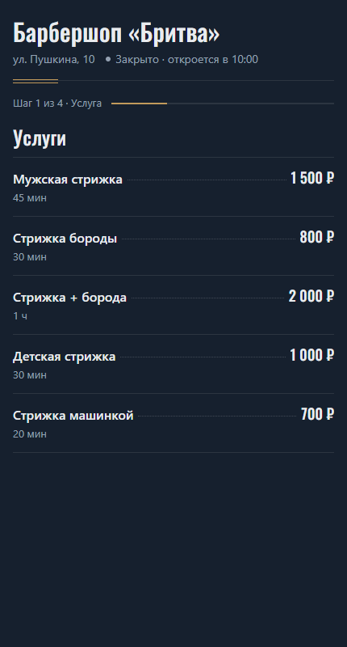
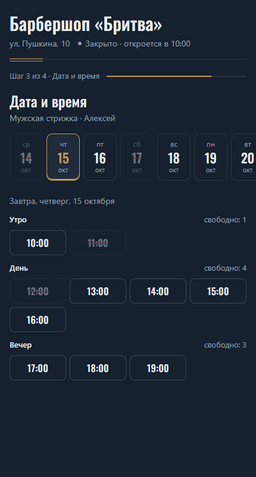
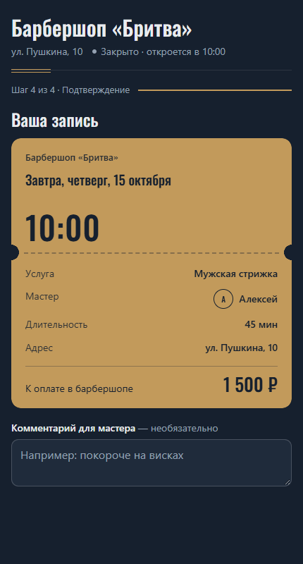
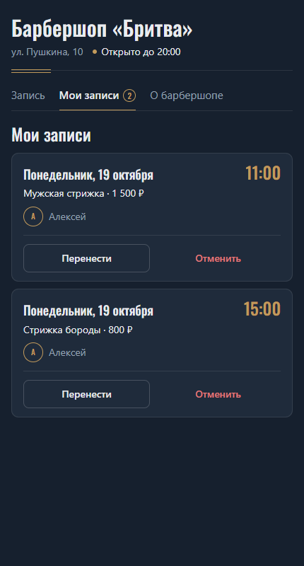
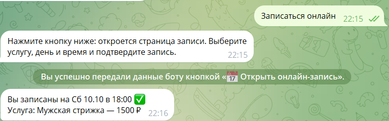
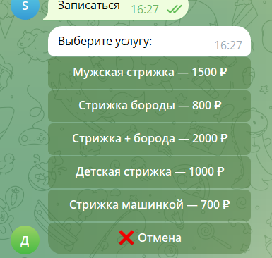

# Бот для записи в барбершоп

Telegram-бот, через который клиенты записываются на стрижку: выбирают услугу, мастера, день и время (кнопками в чате или на странице мини-приложения), смотрят свои записи, переносят и отменяют их. Мастеров несколько, у каждого свой график работы и своё расписание. Мастер и владелец получают уведомления о новых записях, переносах и отменах, а в меню мастера видят расписание, могут отменять записи и закрывать время. Клиентам приходят напоминания о записи за сутки и за 2 часа, а после визита — просьба оценить его. Владелец видит статистику записей и выручки.

## Возможности

- **Несколько мастеров.** Список — в файле `masters.json` (см. [«Мастера»](#мастера)). Каждый мастер делает все услуги. Занятость и закрытое время у каждого свои: к разным мастерам можно записаться на одно и то же время.
- **График мастеров.** У каждого мастера в `masters.json` свои рабочие дни (`work_days`) и часы (`work_hours`). Нерабочее время считается недоступным везде, где бот считает свободное время: в пошаговой записи, в мини-приложении, при проверке записи и переноса. График показывается в «Услуги и цены».
- **Запись по шагам.** Кнопка «Записаться» ведёт клиента по шагам: услуга → мастер → день → время. Вместо конкретного мастера можно выбрать «👥 Любой мастер»: бот покажет время, когда свободен хоть кто-то, и сам выберет мастера — того, у кого в этот день меньше записей. На любом шаге можно нажать «❌ Отмена».
- **Онлайн-запись через Mini App.** Кнопка «Записаться онлайн» открывает страницу записи ([исходники](https://github.com/seniawer/barbershop-miniapp)) прямо внутри Telegram. Бот передаёт странице услуги, мастеров и занятые слоты каждого мастера на 7 дней вперёд, а выбор клиента принимает обратно и перепроверяет: услуга и мастер должны быть в списке бота, цена берётся из бота, дата и время должны быть свободны у этого мастера и в рабочих часах. Если слот успели занять, бот пришлёт новую кнопку с обновлённым расписанием.
- **Услуги и цены.** Мужская стрижка, стрижка бороды, стрижка + борода, детская стрижка, стрижка машинкой. Список с ценами и мастерами открывается кнопкой «Услуги и цены».
- **Только свободное время.** Записаться можно на 7 дней вперёд, с 10:00 до 19:00 (последняя запись). Занятое, закрытое мастером и уже прошедшее время бот не показывает, а дни без свободных окон скрывает.
- **«Мои записи».** Клиент видит свои предстоящие записи (с именем мастера и комментарием), под каждой есть кнопка «Отменить запись». Ниже — кнопка «📋 Открыть мои записи»: мини-приложение откроется сразу на вкладке «Мои записи», где запись можно перенести на другое время у того же мастера или отменить.
- **Комментарий к записи.** В мини-приложении можно оставить комментарий для мастера (необязательно, до 200 символов). Мастер видит его в уведомлении о записи и в меню мастера.
- **«Записаться снова».** Бот передаёт мини-приложению услугу и мастера из последней записи клиента — одна кнопка сразу ведёт к выбору времени.
- **«О барбершопе».** Вкладка мини-приложения: адрес со ссылкой на Яндекс Карты, телефон, часы работы и мастера. Данные — из настроек в `bot.py` (`SHOP_NAME`, `SHOP_ADDRESS`, `SHOP_PHONE`, `SHOP_MAP_QUERY`, часы — из `WORK_HOURS`), сейчас там демо-значения.
- **База SQLite.** Записи хранятся в файле `barbershop.db`, он создаётся сам при первом запуске. База не даёт записать двух клиентов к одному мастеру на одно и то же время.
- **Уведомления.** О новой записи, отмене и подтверждении визита бот пишет мастеру этой записи (если у него в `masters.json` указан `telegram_id`) и всегда владельцу из `ADMIN_ID`: мастер, услуга, дата, время, имя и телефон клиента.
- **Меню мастера.** Команда `/admin` или кнопка «Меню мастера» в главном меню (видна только владельцу и мастерам). Владелец видит записи всех мастеров и может отфильтровать их по мастеру, мастер — только свои. Записи на сегодня, на завтра и на неделю: у каждой записи время, услуга, цена, имя и ник клиента и кнопка «Отменить», в конце дня — число записей и сумма. Отмена — только после подтверждения, клиенту приходит сообщение «Мастер отменил вашу запись на ...».
- **Закрытие времени.** «Закрыть время»: владелец сначала выбирает мастера (мастер закрывает только своё время), затем день на 14 дней вперёд, затем «Весь день» или отдельные часы (кнопки-переключатели) и «Сохранить». Если на закрываемое время уже есть записи, бот покажет их, но не отменит. «Закрытое время» — список закрытых дней и часов с кнопкой «Открыть». Закрытое время считается занятым у этого мастера везде: в пошаговой записи, в мини-приложении и при проверке его данных. Полностью закрытый день в пошаговой записи не показывается, а в мини-приложении неактивен.
- **Телефон клиента.** После первой записи (кнопками или через мини-приложение) бот предлагает «📱 Поделиться номером» или «Пропустить». Принимается только свой контакт. Номер сохраняется в базе и больше не спрашивается (после «Пропустить» — тоже). Мастер видит его в уведомлениях и в меню мастера; если клиент поделился номером уже после записи, мастеру приходит отдельное сообщение.
- **Напоминания.** За 24 часа и за 2 часа до записи клиенту приходит напоминание (с именем мастера) с кнопками «Приду ✅» (клиенту — «Ждём вас!», мастеру и владельцу — «Клиент подтвердил визит») и «Отменить запись» (с подтверждением, мастеру и владельцу — уведомление об отмене). Если запись сделана меньше чем за 24 часа, напоминания за сутки не будет, меньше чем за 2 часа — не будет никаких. Бот проверяет напоминания в фоне раз в минуту; отметки об отправке хранятся в базе, поэтому после перезапуска напоминания не повторяются. Время — по часам компьютера или сервера, как и всё расписание бота.
- **Оценка визита.** Через 2 часа после окончания визита (начало записи + длительность услуги) клиенту приходит просьба оценить его кнопками 1–5, затем бот предлагает написать отзыв или «Пропустить». Оценку и отзыв получают мастер записи и владелец. Отметка об отправке хранится в базе (`review_asked`), поэтому после перезапуска просьба не повторится. Если бот был выключен и визит закончился больше суток назад, просьба уже не отправляется. Визиты, прошедшие до обновления бота, оценить не просим.
- **Статистика для владельца.** Кнопка «Статистика» в меню мастера (видна только владельцу): записи и выручка за текущую неделю (пн–вс) и текущий месяц — всего и по каждому мастеру, средняя оценка мастера и сколько записей ещё впереди. Выручка считается по текущим ценам услуг.
- **Команда `/id`** показывает ваш Telegram ID. Он нужен, чтобы указать владельца (`ADMIN_ID`) и мастеров (`telegram_id` в `masters.json`).

## Технологии

- Python 3.10+
- [aiogram 3](https://docs.aiogram.dev/) — фреймворк для Telegram-ботов (FSM для пошаговой записи, inline-кнопки)
- Telegram Mini App — страница записи на GitHub Pages, данные передаются боту через `Telegram.WebApp.sendData`
- SQLite — встроенная база данных (модуль `sqlite3`)
- python-dotenv — чтение настроек из файла `.env`

## Структура проекта

| Файл | Что внутри |
|------|-----------|
| `bot.py` | Обработчики команд и кнопок, мастера, их график и права доступа, шаги записи, онлайн-запись, перенос и отмена через Mini App, телефон клиента, напоминания, оценка визита, уведомления, меню мастера, закрытие времени и статистика |
| `db.py` | Работа с базой SQLite: создание и обновление таблиц, записи клиентов, комментарии, перенос, телефоны, отметки напоминаний, оценки и отзывы, закрытое время |
| `masters.json` | Список мастеров |
| `requirements.txt` | Зависимости |
| `.env.example` | Образец файла с настройками |
| `deploy/barbershop-bot.service` | Служба systemd для запуска на Linux-сервере |
| `DEPLOY.md` | Инструкция по запуску на сервере Ubuntu |

## Как запустить

1. Создайте бота у [@BotFather](https://t.me/BotFather) и получите токен.

2. Создайте виртуальное окружение и активируйте его:

   ```bash
   python -m venv .venv
   ```

   Windows (PowerShell):

   ```powershell
   .venv\Scripts\Activate.ps1
   ```

   Linux / macOS:

   ```bash
   source .venv/bin/activate
   ```

3. Установите зависимости:

   ```bash
   pip install -r requirements.txt
   ```

4. Скопируйте `.env.example` в `.env` и заполните переменные:

   | Переменная | Описание |
   |-----------|----------|
   | `BOT_TOKEN` | Токен бота от @BotFather (обязательно) |
   | `ADMIN_ID` | Telegram ID владельца: ему приходят все уведомления и в меню мастера видны все мастера. Если оставить пустым, уведомления и меню мастера будут только у мастеров с `telegram_id` |
   | `DB_PATH` | Путь к файлу базы SQLite. Если оставить пустым — `barbershop.db` рядом с `bot.py` |

   Файл `.env` добавлен в `.gitignore`, токен не попадёт в репозиторий.

5. Запустите бота:

   ```bash
   python bot.py
   ```

6. Чтобы включить уведомления и меню мастера: напишите боту `/id`, впишите полученное число в `ADMIN_ID` в файле `.env` (владелец) или в `telegram_id` мастера в `masters.json` и перезапустите бота. Каждый получатель должен хотя бы раз нажать `/start` у бота, иначе Telegram не даст боту написать ему первым.

Как запустить бота на сервере Ubuntu, чтобы он работал круглосуточно, — в [DEPLOY.md](DEPLOY.md).

## Мастера

Мастера описаны в файле `masters.json` рядом с `bot.py`. Для примера там три вымышленных мастера:

```json
[
  {"id": "alex", "name": "Алексей", "description": "Классика и фейды, 8 лет опыта", "telegram_id": null,
   "work_days": ["пн", "вт", "ср", "чт", "пт"], "work_hours": [10, 20]},
  {"id": "boris", "name": "Борис", "description": "Бороды и опасная бритва", "telegram_id": null,
   "work_days": ["вт", "ср", "чт", "пт", "сб"], "work_hours": [12, 20]},
  {"id": "vika", "name": "Виктория", "description": "Модные и детские стрижки", "telegram_id": null,
   "work_days": ["ср", "чт", "пт", "сб", "вс"], "work_hours": [10, 18]}
]
```

| Поле | Описание |
|------|----------|
| `id` | Короткий код мастера: строчные латинские буквы, цифры, `_` или `-`, до 16 символов (кроме `any` и `all`). Хранится в базе — после появления записей его не меняйте |
| `name` | Имя, которое видят клиенты |
| `description` | Короткое описание (необязательно). Показывается при выборе мастера |
| `telegram_id` | Telegram ID мастера (необязательно, `null` — нет). Мастеру с ID приходят уведомления о его записях и доступно меню мастера |
| `work_days` | Рабочие дни: список из `пн`, `вт`, `ср`, `чт`, `пт`, `сб`, `вс` (необязательно, по умолчанию — все дни) |
| `work_hours` | Рабочие часы `[начало, конец]`: `[12, 20]` — с 12:00 до 20:00, последняя запись в 19:00. В пределах часов барбершопа `WORK_HOURS` (необязательно, по умолчанию — все часы барбершопа) |

Если график мастера изменился, а записи на прежнее время уже есть, они не отменяются — бот только перестаёт предлагать нерабочее время. Файл читается при запуске: после изменений перезапустите бота. Если в файле ошибка, бот не запустится и напишет, что не так. Мастера, у которого есть предстоящие записи, лучше не удалять из списка: его записи останутся в базе, но в меню мастера их не будет видно.

**Обновление старой базы.** В базе, созданной до появления нескольких мастеров, при первом запуске все записи и закрытое время привязываются к первому мастеру из `masters.json`. Для этого таблицы `bookings` и `closed_time` пересоздаются (SQLite не умеет менять ограничение `UNIQUE` у существующей таблицы): новая таблица → перенос всех строк с теми же id → удаление старой → переименование. Всё это в одной транзакции: если что-то пойдёт не так, база останется прежней. Перед обновлением всё равно стоит сделать копию файла базы.

## Меню мастера

Доступно владельцу (`ADMIN_ID`) и мастерам, у которых в `masters.json` указан `telegram_id`:

- **владелец** видит записи всех мастеров и под списком переключает фильтр «Все / Алексей / Борис / ...», закрывает и открывает время любому мастеру;
- **мастер** видит только свои записи, закрывает и открывает только своё время.

Права проверяются в каждом обработчике меню мастера и в каждой его inline-кнопке: фильтр `IsStaff` пропускает только владельца и мастеров, а id мастера из кнопки или записи обработчик ещё раз сверяет с тем, кем управляет пользователь (`can_manage` / `staff_view` в `bot.py`, условие на мастера в запросах `db.cancel_booking` и `db.open_time`). Поэтому отправить текст «Записи на сегодня» или подделать нажатие кнопки посторонний не сможет, а мастер не отменит чужую запись и не закроет чужое время: команда `/admin` ответит «доступно только мастеру», а кнопки — сообщением об отказе.

Если владелец отменяет запись мастера, мастеру приходит уведомление, и наоборот.

| Кнопка | Что делает |
|--------|-----------|
| Записи на сегодня / На завтра | Записи на день (с мастером, телефоном клиента и отметкой «✅ подтвердил визит») с кнопкой «Отменить» у каждой, внизу — число записей и сумма. У владельца — кнопки фильтра по мастеру |
| На неделю | То же по каждому дню с записями на 7 дней вперёд и общий итог за неделю. У владельца под итогом — фильтр по мастеру (неделя присылается заново) |
| Закрыть время | Владелец выбирает мастера, затем день (🔒 — закрыт целиком, 🔸 — закрыты отдельные часы), затем «Весь день» или часы. 👤 — на этот час к мастеру уже кто-то записан |
| Закрытое время | Закрытые дни и часы начиная с сегодня по мастерам, у каждого кнопка «🔓 Открыть» |
| Статистика | Только у владельца: записи и выручка за неделю и месяц, всего и по мастерам |
| Клиентское меню | Возврат в обычное меню |
| `/test_reminder` | Сразу отправляет напоминание по ближайшей предстоящей записи (владелец — любого мастера, мастер — своей). Отметку в базе не ставит — обычные напоминания по этой записи придут по расписанию |
| `/test_review` | Сразу присылает вам просьбу оценить визит по вашей последней записи (запишитесь сами как клиент). Отметку в базе не ставит |

Закрытое время хранится в таблице `closed_time`, телефоны — в таблице `clients` (обе создаются сами при запуске). У записей и закрытого времени есть колонка `master_id`. В таблицу `bookings` при первом запуске добавляются колонки с именем и ником клиента, отметки напоминаний (`reminded_24h`, `reminded_2h`) и подтверждения визита (`confirmed`), комментарий (`comment`), отметка о просьбе оценить визит (`review_asked`), оценка (`rating`) и отзыв (`review`); уже сохранённые записи не теряются, а для них имя бот спрашивает у Telegram. Перед обновлением бота сделайте копию файла базы.

## Как устроена онлайн-запись

1. Клиент нажимает «Записаться онлайн» (или «Мои записи»). Бот присылает кнопку «📅 Открыть онлайн-запись» (или «📋 Открыть мои записи») в обычной клавиатуре под полем ввода. Именно в ней, а не в inline-кнопке под сообщением: `sendData` работает только для мини-приложений, открытых из такой клавиатуры.
2. Адрес страницы собирается при каждом нажатии: `https://seniawer.github.io/barbershop-miniapp/?d=eyJ2IjoxLCJkIjoi...`. В параметре `d` — компактный JSON в base64url (функции `miniapp_data` и `miniapp_url` в `bot.py`): название, адрес, телефон барбершопа и запрос для Яндекс Карт, услуги с ценами и длительностью (`SERVICE_MINUTES`), мастера с описаниями и занятость каждого мастера по дням, предстоящие записи этого клиента (до 10) и услуга с мастером его последней записи. Занятость дня — одно число, битовая маска часов (бит 0 — 10:00, бит 1 — 11:00, ...); закрытое мастером и нерабочее время в ней считается занятым. Параметр `t=my` открывает сразу вкладку «Мои записи». Поэтому страницу не нужно править при смене услуг, цен или мастеров.
3. Клиент выбирает услугу, мастера (или «Любой мастер»), день и время, при желании пишет комментарий и нажимает «Записаться». Страница отправляет боту JSON и закрывается. Поле `action` говорит, что сделать:

   | `action` | JSON | Что делает бот |
   |----------|------|----------------|
   | `book` (или поля нет — так присылала старая страница) | `{"action": "book", "service": "haircut", "master": "boris", "date": "2026-10-08", "time": "12:00", "comment": "покороче"}` | Записывает. `master` — id мастера или `any`, `comment` необязателен |
   | `cancel` | `{"action": "cancel", "id": 42}` | Отменяет запись |
   | `reschedule` | `{"action": "reschedule", "id": 42, "date": "2026-10-09", "time": "15:00"}` | Переносит запись на другое время у того же мастера |

4. Бот всё проверяет сам: услуга и мастер — из его списков, дата и время — в пределах расписания, время у мастера рабочее, свободное и не закрыто. Для отмены и переноса — что запись с этим `id` принадлежит именно этому клиенту и ещё не началась; новое время при переносе ещё раз проверяется в базе (`UNIQUE` и закрытое время), напоминания и подтверждение визита сбрасываются под новое время. Затем бот сохраняет изменения в ту же базу, что и пошаговая запись, отвечает клиенту и уведомляет мастера и владельца. Если время успели занять, бот пришлёт новую кнопку с обновлённым расписанием.

**Длина адреса.** С тремя мастерами, пятью услугами и парой записей клиента адрес занимает около 1200 символов. Бот следит, чтобы он не превышал `MINIAPP_URL_LIMIT` (2048 символов — наш запас, Telegram точного лимита не публикует): если адрес выходит длиннее, описания мастеров в него не передаются, а если и это не помогает — в лог пишется предупреждение.

Адрес страницы хранится в константе `MINIAPP_URL` в `bot.py`. Настраивать в @BotFather ничего не нужно. Страницу и бота нужно обновлять вместе: старая страница (с параметром `busy`) с новым ботом не работает. Страница предыдущей версии (без вкладок) с этим ботом работает — новые поля она просто не читает.

**Выбор услуги в мини-приложении**



**Выбор дня и времени, занятые слоты неактивны**



**Талон записи перед подтверждением**



**Мои записи: перенос и отмена**



**Ответ бота после онлайн-записи**



## Скриншоты

**Приветствие и главное меню**


**Выбор услуги**



**Выбор времени**


**Подтверждение записи и уведомление администратору**


