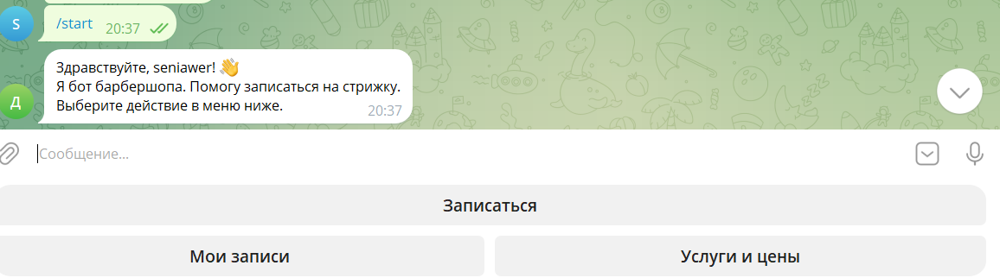
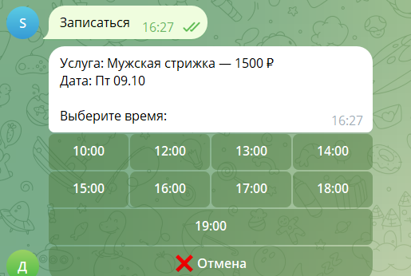
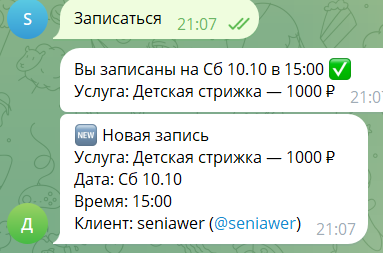

# Бот для записи в барбершоп

Telegram-бот, через который клиенты записываются на стрижку: выбирают услугу, день и время, смотрят свои записи и при необходимости отменяют их. Администратор получает уведомление о каждой новой записи и отмене.

## Возможности

- **Запись по шагам.** Кнопка «Записаться» ведёт клиента по шагам: услуга → день → время. На любом шаге можно нажать «❌ Отмена».
- **Услуги и цены.** Мужская стрижка, стрижка бороды, стрижка + борода, детская стрижка, стрижка машинкой. Список с ценами открывается кнопкой «Услуги и цены».
- **Только свободное время.** Записаться можно на 7 дней вперёд, с 10:00 до 19:00 (последняя запись). Занятое и уже прошедшее время бот не показывает, а дни без свободных окон скрывает.
- **«Мои записи».** Клиент видит свои предстоящие записи, под каждой есть кнопка «Отменить запись».
- **База SQLite.** Записи хранятся в файле `barbershop.db`, он создаётся сам при первом запуске. База не даёт записать двух клиентов на одно и то же время.
- **Уведомления администратору.** О новой записи и об отмене бот пишет администратору: услуга, дата, время и имя клиента.
- **Команда `/id`** показывает ваш Telegram ID. Он нужен, чтобы указать администратора в настройках.

## Технологии

- Python 3.10+
- [aiogram 3](https://docs.aiogram.dev/) — фреймворк для Telegram-ботов (FSM для пошаговой записи, inline-кнопки)
- SQLite — встроенная база данных (модуль `sqlite3`)
- python-dotenv — чтение настроек из файла `.env`

## Структура проекта

| Файл | Что внутри |
|------|-----------|
| `bot.py` | Обработчики команд и кнопок, шаги записи, уведомления администратору |
| `db.py` | Работа с базой SQLite: создание таблицы, добавление, поиск и удаление записей |
| `requirements.txt` | Зависимости |
| `.env.example` | Образец файла с настройками |

## Как запустить

1. Создайте бота у [@BotFather](https://t.me/BotFather) и получите токен.

2. Создайте виртуальное окружение и активируйте его:

   ```bash
   python -m venv .venv
   ```

   Windows (PowerShell):

   ```powershell
   .venv\Scripts\Activate.ps1
   ```

   Linux / macOS:

   ```bash
   source .venv/bin/activate
   ```

3. Установите зависимости:

   ```bash
   pip install -r requirements.txt
   ```

4. Скопируйте `.env.example` в `.env` и заполните переменные:

   | Переменная | Описание |
   |-----------|----------|
   | `BOT_TOKEN` | Токен бота от @BotFather (обязательно) |
   | `ADMIN_ID` | Telegram ID администратора, которому приходят уведомления. Если оставить пустым, бот работает без уведомлений |

   Файл `.env` добавлен в `.gitignore`, токен не попадёт в репозиторий.

5. Запустите бота:

   ```bash
   python bot.py
   ```

6. Чтобы включить уведомления: напишите боту `/id`, впишите полученное число в `ADMIN_ID` в файле `.env` и перезапустите бота. Администратор должен хотя бы раз нажать `/start` у бота, иначе Telegram не даст боту написать ему первым.

## Скриншоты

**Приветствие и главное меню**



**Выбор услуги**


**Выбор времени**



**Подтверждение записи и уведомление администратору**


